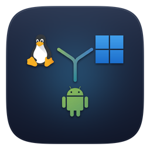

<div align="center">



# Y Connect

**Keep your Android phone and your Linux or Windows computer in sync over your local network. No cloud. No account.**

Notifications · Clipboard · File transfer · Battery status · Remote commands


</div>

## From the author

Hi, I'm Yokeswaran N, an 18-year-old student. I made Y Connect, inspired by [KDE Connect](https://invent.kde.org/network/kdeconnect-kde). I hope to add more features over time.

If you find an issue, feel free to contact me on [Discord](https://discord.com/users/895560596064464956) or [Reddit](https://www.reddit.com/user/yokeswaran_n), or [report it on GitHub](https://github.com/Yokeswaran4/Y-Connect/issues). You can also browse the [source repository](https://github.com/Yokeswaran4/Y-Connect) or get the latest builds from [Releases](https://github.com/Yokeswaran4/Y-Connect/releases).

**Website:** the project page lives in [`docs/`](docs/) and is served with GitHub Pages (Settings → Pages → Deploy from a branch → `/docs`).

## Table of contents

1. [What's new](#whats-new)
2. [Overview](#overview)
3. [Features](#features)
4. [Screenshots](#screenshots)
5. [Downloads](#downloads)
6. [Requirements](#requirements)
7. [Building from source](#building-from-source)
8. [Pairing your devices](#pairing-your-devices)
9. [Android one-time setup](#android-one-time-setup)
10. [Using the app](#using-the-app)
11. [File transfer](#file-transfer)
12. [Battery and connection latency](#battery-and-connection-latency)
13. [Remote commands](#remote-commands)
14. [Security and privacy](#security-and-privacy)
15. [Network and firewall](#network-and-firewall)
16. [Protocol reference](#protocol-reference)
17. [Settings and configuration](#settings-and-configuration)
18. [Troubleshooting](#troubleshooting)
19. [Theming](#theming)
20. [Project structure](#project-structure)
21. [Tech stack and credits](#tech-stack-and-credits)
22. [Made with AI](#made-with-ai)
23. [License](#license)
24. [Contact](#contact)

---

## What's new

- **Android animations.** Tabs slide and fade in the direction you move, cards rise in one after another, counters roll when their number changes, the bottom bar icon pops when selected, and the logo spins in on start. Only graphics layers are animated, so it stays smooth on slower phones. Back gestures use Android's predictive back animation.
- **Leftovers from the old name are cleaned up.** The desktop app removes old menu entries, startup entries and icons and refreshes the icon cache. The Android app shows an *Uninstall* card on the Devices page if the old app is still installed.
- **Check for updates.** Android: *About → Updates*. Linux and Windows: *Settings → About & updates*. "Check now" asks GitHub for the latest release. The switch **Notify me about new releases** (off by default) checks about once a day and shows one notification per new version. This is the only feature that uses the internet; it sends nothing about you or your devices.
- **Smoother Android UI.** Cards no longer animate one by one with springs; tabs use a quick fade. Below-the-fold cards load a moment after the page, and the slow start-up work (key derivation, sockets) runs off the main thread.
- **Shorter "About this device".** Only device, system and app version are shown. CPU, build and other details are added to the debug report when you copy or share it.
- **Website.** Interactive preview (pair, send files, run commands), live latest-release panel with a version checker, FAQ, expandable feature cards.

## Overview

Y Connect links Android phones, Linux computers and Windows computers on the same Wi-Fi or LAN. Copy text on a computer and paste it on your phone, receive phone notifications on your desktop, or send files and folders between paired devices. Messages and files are encrypted, and they stay on your local network. The project is inspired by [KDE Connect](https://invent.kde.org/network/kdeconnect-kde), an open-source project that connects devices across platforms.

| App | Platforms | Built with |
|---|---|---|
| Desktop | Linux (AppImage), Windows (installer and portable `.exe`) | Electron, Node.js |
| Android | Android 10+ (API 29) | Kotlin, Jetpack Compose, Material 3 |

## Features

| Feature | What it does |
|---|---|
| Clipboard | Sync text between desktop and Android. Desktop-to-phone is automatic; Android-to-desktop can be sent with a tile, notification action, Share menu, or optional automatic mode. |
| Notifications | Mirror Android notifications to connected devices. Linux desktop notifications can also be forwarded when `dbus-monitor` is installed. |
| File transfer | Send files and folders in either direction, with progress, cancellation, collision-safe filenames, and resume after a disconnect. |
| Device discovery | Find devices automatically over UDP, with a Connect by IP option for networks that block discovery. |
| Pairing | Pair devices with a code that is not transmitted over the network. |
| Battery and latency | See connected devices' battery status and encrypted-link latency. |
| Remote commands | Run commands from Android on a paired Linux or Windows computer. This is off by default. |
| Privacy | No cloud service, relay, or account is required. |

## Screenshots

The sample screenshots below are included in the repository under [`assets/`](assets/).

<details>
<summary>Show Android and desktop screenshots</summary>

| Android | Desktop |
|---|---|
|  |  |
|  |  |
|  |  |

</details>

## Downloads

Get the latest builds from **[Y Connect Releases](https://github.com/Yokeswaran4/Y-Connect/releases)**.

| File | Platform | Description |
|---|---|---|
| `Y-Connect-v1.1.apk` | Android 10 (API 29) or newer | Installable Android package. |
| `Y-Connect-v1.1.AppImage` | Linux (x64) | Desktop app. Make it executable before starting it. |
| `Y-Connect-Setup-v1.1.exe` | Windows | Installer. |
| `Y-Connect-Portable-v1.1.exe` | Windows | Portable build that needs no installation. |

Run the AppImage:

```bash
chmod +x Y-Connect-v1.1.AppImage
./Y-Connect-v1.1.AppImage
```

When installing the APK outside Google Play, Play Protect may show a warning or block installation. Keep Play Protect enabled: confirm the APK came from the official Releases page, compare its SHA-256 checksum with the one published in the release notes, and review the permissions Android requests. If Play Protect still blocks the APK, do not bypass the warning; cancel the installation and wait for a verified build or contact the author.

## Requirements

| Component | Requirement |
|---|---|
| Desktop (build) | Node.js **20 or newer** and npm |
| Desktop (run) | Linux (x64 AppImage) or Windows |
| Android (build) | Android Studio Ladybug or newer, **JDK 17 or 21** (Java 25 does not work with Gradle 8.9), Gradle 8.9 |
| Android (run) | Android **10 or newer** (API 29); compiled against API 35 |
| Network | All devices on the same LAN or Wi-Fi |
| Optional (Linux) | `dbus-monitor` (package `dbus` or `dbus-bin`) to forward this computer's notifications; `wl-clipboard` for reliable clipboard sync on Wayland |

## Building from source

```bash
git clone https://github.com/Yokeswaran4/Y-Connect.git
cd Y-Connect
```

### Desktop app (Linux and Windows)

```bash
cd desktop
npm install
npm start            # run directly to test
```

Build a distributable (build each platform on its own operating system where possible):

```bash
npm run dist:linux   # Linux AppImage    -> dist/Y-Connect-v1.1.AppImage
npm run dist:win     # Windows installer -> dist/Y-Connect-Setup-v1.1.exe
                     # Windows portable  -> dist/Y-Connect-Portable-v1.1.exe
```

Building the Windows files on Linux can need Wine. If that fails, build on a Windows computer instead.

Run the transfer tests (they use in-memory sockets, so neither Electron nor a network is needed):

```bash
npm test
```

Notes:

- Closing the window **hides it to the tray**. Choose **Quit** from the tray menu to stop the app.
- Only one instance can run at a time.
- Linux builds disable GPU acceleration and the Chromium sandbox to avoid blank windows and `/dev/shm` crashes on varied setups. If the window feels slow, start Y Connect with `YCONNECT_GPU=1` (for example `YCONNECT_GPU=1 ./Y-Connect.AppImage`) to render on the GPU instead.
- Started from an AppImage, the app writes `~/.local/share/applications/y-connect.desktop` and an icon under `~/.local/share/icons/` on every start so launchers and docks can match the window to its icon. If you move the AppImage, start it once from its new location.

### Android app

**Android Studio**

1. Open the `android/` folder in Android Studio and let Gradle sync. If Android Studio reports an invalid or incompatible Gradle JDK, choose JDK 17 or 21 under **Settings → Build, Execution, Deployment → Build Tools → Gradle → Gradle JDK**.
2. Connect a phone and press **Run**, or choose **Build → Build Bundle(s) / APK(s) → Build APK(s)**.

**Terminal**

The Gradle wrapper jar is not bundled. Either install Gradle 8.9 or generate the wrapper once:

```bash
cd android
export JAVA_HOME=/path/to/jdk-17-or-21
export ANDROID_HOME=$HOME/Android/Sdk
echo "sdk.dir=$ANDROID_HOME" > local.properties
gradle wrapper --gradle-version 8.9    # once
./gradlew assembleDebug
```

The APK is written to `android/app/build/outputs/apk/debug/app-debug.apk`. Rename it to `Y-Connect-v1.1.apk` when you publish it.

> **Smoothness:** debug builds are noticeably slower because Jetpack Compose isn't optimised in them. For day-to-day use, build the release variant instead (`gradle assembleRelease`, or **Build > Select Build Variant > release** in Android Studio). It is optimised with R8 and signed with the debug key so it installs directly. The APK is at `android/app/build/outputs/apk/release/app-release.apk`.

If you use the **fish** shell, set variables with `set -x JAVA_HOME /path/to/jdk` instead of `export`.

Details: `applicationId` and namespace `com.yokeswaran.yconnect`, `minSdk 29`, `targetSdk 35`, `compileSdk 35`, Java and Kotlin target 17, Compose BOM `2024.10.01`.

> The manifest requests `QUERY_ALL_PACKAGES` so notifications show real app names. This is intended for sideloaded builds and is **not suitable for Google Play** as-is.

### Automatic builds with GitHub Actions

The workflow in `.github/workflows/build.yml` builds the Android APK, the Linux AppImage and the Windows installers on every push. Run it manually from the **Actions** tab with **Run workflow**. When a run finishes, download the files from its **Artifacts** section. Artifacts are temporary; upload the files you want to publish to a **Release**.

## Pairing your devices

1. Connect all devices to the **same Wi-Fi or LAN** and open Y Connect on each.
2. Open **Devices**. Other Y Connect devices on the network appear under **Nearby devices**.
3. Select the device you want to pair with. This device displays a pairing code, and the other device asks you to enter it.
4. Enter the displayed code on the other device and press **Pair**.

If you miss the pairing prompt, choose **I have a code** under Nearby devices or enter the code in **Settings**. The pairing code is never sent over the network; only a request to ask for the code is sent. Entering a new code replaces the current one, so use the same code on every device you want to connect.

To disconnect a device and stop it reconnecting, select **Unpair** on its device card. The device appears under Nearby devices again and can be paired later.

If automatic discovery does not work (for example on guest Wi-Fi or a network with access-point isolation), use **Connect by IP**.

## Android one-time setup

- **Notification access:** Select **Grant notification access** in the app and enable Y Connect. On Android 13+ with a sideloaded app, you may first need **Settings → Apps → Y Connect → ⋮ → Allow restricted settings**.
- **Battery:** Set Y Connect to **Unrestricted** using the in-app button so Android is less likely to stop the background connection.
- **Notifications:** Allow notifications when prompted. They are used for the background service and for displaying notifications from other devices.
- **Clipboard tile (optional):** Add the **Send clipboard** tile using the Quick Settings edit menu.
- **Automatic clipboard sending (optional):** Enable **Settings → Sync → Send clipboard automatically** and grant the **Display over other apps** permission when prompted.

## Using the app

### Desktop tabs

| Tab | What it does |
|---|---|
| **Devices** | Connected and nearby devices, battery and latency details, and Connect by IP. Send files or folders from a connected device card; drag and drop files onto a device. |
| **Transfers** | View active and completed file transfers. |
| **Sync** | Configure clipboard, notifications, battery sharing, incoming files, and remote control. |
| **Activity** | Review recent connection, notification, clipboard, and error events. |
| **Settings** | Configure theme, startup behavior, device name, pairing code, and other device options. |
| **Contact / Licenses** | Contact links, the project license, and third-party notices. |

### Android tabs

The Android app provides **Devices**, **Files**, **Run**, **Activity**, **Settings**, and **About**.

### Clipboard

| Direction | Behavior |
|---|---|
| Desktop → Android | Text is copied to the phone automatically when clipboard sync is enabled. |
| Android → desktop | Use the Send clipboard tile, the persistent notification action, **Share → Y Connect**, or **Send clipboard now** in Settings. Optional automatic sending is available in **Settings → Sync**. |

Android 10 and newer restrict background clipboard reads. Optional automatic sending uses **Display over other apps** to briefly open an invisible foreground activity that reads and sends the changed clipboard text. Some phone manufacturers restrict background activity starts further; if automatic sending does not work, use one of the manual options above. Clipboard sync supports plain text up to 1 MB.

**Linux on Wayland** (GNOME, KDE, niri, sway, Hyprland): install `wl-clipboard` (`sudo pacman -S wl-clipboard`, `sudo apt install wl-clipboard` or `sudo dnf install wl-clipboard`) and restart the app. The app then uses `wl-paste` and `wl-copy`, which work while the window is in the background. Without them it falls back to Electron's clipboard, which Wayland may block.

### Notifications

- Android notifications are mirrored to connected devices when notification access is granted.
- Linux desktop notifications can be forwarded when `dbus-monitor` is installed. The desktop looks up the sending app's icon in your installed icon themes and sends it along.
- Windows desktop notifications are not forwarded to other devices.
- The desktop app can send a test notification to check the connection.

## File transfer

File transfer works in every direction (Android ⇄ desktop and desktop ⇄ desktop) and supports any file type. Files are encrypted with the pairing-code key and sent directly over the LAN.

| Sender | How to send |
|---|---|
| Desktop | Choose **Send file** or **Send folder** on a connected device, or drag and drop files or folders onto that device's row. |
| Android | Choose **Send file** or **Send folder** under a connected device, or use **Share → Y Connect** from another app. |

Received files are saved in `Downloads/YConnect/` on desktop and Android. Existing files are not overwritten; a name such as `photo.jpg` becomes `photo (1).jpg` if it already exists.

Folders and their subfolders are recreated at the destination. Symbolic links and empty folders are skipped. The **Accept incoming files** switch lets a device decline incoming transfers.

If a connection drops during a transfer, the received part is kept and the sender can continue automatically when the device reconnects, or you can press **Resume**. Resume uses the same unchanged file; cancelling removes its partial transfer. Unfinished partial files are deleted after 7 days.

## Battery and connection latency

Connected devices share battery level and charging state, shown on their device cards (for example `🔋 85%` or `⚡ 40%`). Phones report changes as they happen; laptops are checked about once a minute. Desktop computers without batteries report no battery status. Battery sharing can be disabled under **Sync**.

Latency is measured over the encrypted connection. The app shows current and historical measurements, including average, best, worst, jitter, and packet loss. It can be disabled with the device's latency controls.

## Remote commands

The Android **Run** tab can run a command on a paired Linux or Windows computer and show its output. Remote commands are **off by default**; on the computer, enable **Sync → Remote control from your phone → Allow commands from phone** to use them.

- Commands run as the normal user, never elevated, with stdin closed and a selectable timeout (30, 60 or 120 seconds). Output is capped at 48 KB.
- Requests are accepted only from a paired Android device and appear in **Activity** on the computer.
- Delete commands (including `rm`, `del`, `Remove-Item` and similar) and common elevation commands (`sudo`, `su`, `runas` and similar) are refused.
- Saved and recent commands are stored on the phone.
- On Linux, commands that need root, such as `shutdown now`, are refused. Commands that a normal user may run, such as `systemctl poweroff` or `systemctl reboot`, work. Commands that talk to your desktop session (for example `niri msg ...`) only work if Y Connect was started from inside that session.

The delete and elevation checks are guard rails, **not a security sandbox**. A determined command can still change files in other ways. Keep remote control off when it is not needed.

## Security and privacy

- WebSocket messages and file-transfer data are encrypted with AES-256-GCM. The key is derived from the pairing code using PBKDF2-SHA256.
- Pairing codes are not broadcast or transmitted as part of the pairing request. Messages from devices that use a different code cannot be decrypted and are dropped.
- Device discovery uses UDP broadcast, and data connections are made directly between devices. The app does not require a cloud service, relay, or account.
- Received file paths are sanitized, files are not overwritten, and data beyond the announced file size is rejected.
- Debug reports omit clipboard text, notification text, IP addresses, serial numbers, and the pairing code.

Pair only with devices you trust and use a strong, non-obvious pairing code if you set one yourself. Anyone on the local network who knows the code can communicate with your devices.

## Network and firewall

| Port | Protocol | Purpose |
|---|---|---|
| **48998** | TCP | Encrypted WebSocket connections |
| **48999** | UDP | Device discovery and pairing requests |

- **Windows:** accept the firewall prompt on first launch and allow access on private networks.
- **Linux with ufw:**

  ```bash
  sudo ufw allow 48998/tcp
  sudo ufw allow 48999/udp
  ```

Guest networks and routers with client/AP isolation may block device-to-device traffic. Use a network that permits local communication, or connect by IP.

## Protocol reference

Devices discover one another with UDP broadcasts on port 48999 every 3 seconds. A beacon contains the app identifier (`yconnect`), device ID, name, platform, and WebSocket port. Pairing requests are sent directly by UDP and do not contain the pairing code.

The encrypted transport uses WebSocket on TCP port 48998. Each text frame contains base64-encoded `iv[12] + ciphertext + tag[16]` for a JSON message. The key is derived using `PBKDF2-SHA256(UPPERCASE(code without symbols), "y-connect-v1", 100000 iterations, 32 bytes)`.

| Message | Fields / purpose |
|---|---|
| `hello` | `id, name, platform` |
| `clipboard` | `text` |
| `notification` | `app, title, text, icon` |
| `battery` | `level, charging` |
| `unpair` | Mark the other device as unpaired |
| `ping` / `pong` | Measure encrypted-link latency |
| `cmd-run` / `cmd-cancel` / `cmd-result` | Remote command requests and results |
| `file-offer` / `file-accept` / `file-reject` | Negotiate a file transfer |
| Binary frames / `file-end` / `file-ack` | Transfer encrypted chunks and finish or acknowledge a file |
| `file-cancel` | Cancel a transfer |

File data is sent in encrypted binary frames containing a transfer ID and up to 64 KiB of data. Optional transfer identifiers and offsets support resuming interrupted files. Receivers sanitize each path component and reject data beyond the announced size.

## Settings and configuration

Desktop settings are stored in `config.json` in Electron's user-data directory. Common options include:

| Setting | Default | Purpose |
|---|---|---|
| Device ID | Random UUID | Identifies this device |
| Device name | Operating-system hostname | Name shown to other devices |
| Pairing code | Randomly generated | Shared encryption secret |
| Clipboard sync | On | Enable clipboard synchronization |
| Notification sync | On | Send and show notifications |
| Battery sharing | On | Share battery status |
| Accept incoming files | On | Receive or decline file transfers |
| Allow commands | Off | Allow paired Android devices to run commands |
| Launch on startup | Off | Start the desktop app at login |
| Theme | System | Follow system, light, or dark appearance |

## Troubleshooting

<details>
<summary>Devices do not appear or connect</summary>

- Confirm all devices are on the same Wi-Fi or LAN and Y Connect is open.
- Check that TCP **48998** and UDP **48999** are allowed through the firewall.
- Guest Wi-Fi and AP/client isolation can block device discovery or connections. Try **Connect by IP** on a network that permits local traffic.
- If pairing was missed, choose **I have a code** and enter the code shown on the other device.
- If devices appear but nothing syncs, they probably use different pairing codes. Re-enter the same code on both devices. Check that every device runs the same Y Connect version.

</details>

<details>
<summary>Android notifications or background connection do not work</summary>

- Grant notification access to Y Connect.
- On Android 13+ with a sideloaded app, allow restricted settings if Android requires it.
- Set Y Connect's battery usage to **Unrestricted** and allow notifications for the background service.
- Check the Activity page on the phone: a "Notification sent" entry means the phone forwarded the notification and the problem is on the receiving side.

</details>

<details>
<summary>Clipboard sync or file transfer does not work</summary>

- On Linux with Wayland, install `wl-clipboard` and restart the app.
- For Android-to-desktop clipboard sending, use the tile, persistent notification action, Share menu, or enable automatic sending and grant its overlay permission.
- If automatic clipboard sending is blocked by the phone, use one of the manual send options.
- If a file transfer is interrupted, reconnect the devices and use **Resume** or send the same unchanged file again.
- A file shared from another Android app may need to be selected and shared again if Android has withdrawn access to it.

</details>

<details>
<summary>Desktop notifications or remote commands do not work</summary>

- Linux notification forwarding requires `dbus-monitor` (provided by the `dbus` or `dbus-bin` package).
- Windows does not forward its own desktop notifications.
- Remote commands require **Allow commands from phone** to be enabled on the computer. This setting is off by default.
- Open the **Run** tab on the phone and read the "Why this happened" text under a failed command.
- For a useful bug report, open **About this device** and copy or save the debug report.

</details>

<details>
<summary>The app shows the wrong icon in the dock</summary>

- Start the AppImage once; it writes its own menu entry and icon. Restart your dock or panel if it caches icons.
- Check the window's app ID. On niri, `niri msg windows` should list the app ID `y-connect`.

</details>

<details>
<summary>Build problems</summary>

- **Invalid or incompatible Gradle JDK:** use JDK 17 or 21 for Gradle 8.9; JDK 25 is too new.
- **No Android SDK:** set `ANDROID_HOME` and put `sdk.dir=...` into `android/local.properties`.
- **Windows build on Linux fails:** install Wine, or build on Windows.

</details>

## Theming

- **Windows and Linux:** follows the operating-system light/dark setting. Windows uses the system accent color when enabled; Linux uses the Y Connect blue.
- **Android:** follows the system light/dark setting and uses the same Y Connect look as the Linux and Windows apps by default. Android 12+ can switch to Material You wallpaper colors under **Settings**.

## Project structure

```text
Y-Connect/
├── README.md                       This documentation
├── LICENSE                         GNU General Public License v3
├── THIRD-PARTY-NOTICES.txt         Licenses of the components Y Connect uses
├── assets/                         Logo and sample screenshots used in this README
├── .github/workflows/build.yml     CI build for Android, Linux and Windows
│
├── desktop/                        Electron app (Linux and Windows)
│   ├── main.js                     App core: config, discovery, pairing, WebSocket server/client, tray, IPC
│   ├── preload.js                  Safe bridge between the main process and the UI
│   ├── transfer.js                 Encrypted chunked file transfer, folders, resume
│   ├── remote.js                   Remote command execution and safety checks
│   ├── battery.js                  Battery reading (Linux sysfs / Windows Win32_Battery)
│   ├── latency.js                  Ping/pong latency tracker
│   ├── legacy.js                   Removes menu/startup entries and icons left by the old name
│   ├── notifwatch.js               Linux: watches desktop notifications via dbus-monitor
│   ├── autostart.js                Launch on startup (Windows login item / Linux XDG autostart)
│   ├── deviceinfo.js               "About this device" and debug report
│   ├── renderer/                   UI (index.html, renderer.js, styles.css, logo.png)
│   ├── test/transfer.test.js       Loopback tests: folders, resume, cancel, hostile paths
│   ├── licenses/                   License texts shown inside the app
│   ├── build/icon.png              App icon
│   └── package.json                Dependencies and electron-builder configuration
│
└── android/                        Android Studio project
    ├── build.gradle.kts, settings.gradle.kts, gradle/wrapper/
    └── app/src/main/
        ├── AndroidManifest.xml
        ├── assets/licenses/        License texts shown inside the app
        ├── res/                    Icons (adaptive icon included), themes, strings
        └── java/com/yokeswaran/yconnect/
            ├── MainActivity.kt                    Entry point
            ├── Ui.kt                              Main Compose UI (Devices, Files, Activity, Settings, About)
            ├── RunUi.kt / RemoteCommands.kt       "Run" tab and command protocol
            ├── LatencyUi.kt / Latency.kt          Latency graph and tracker
            ├── LegacyApp.kt                       Finds a leftover copy of the old app so it can be uninstalled
            ├── Hub.kt                             Core: discovery, pairing, WebSocket, state
            ├── Crypto.kt                          PBKDF2 and AES-256-GCM
            ├── Transfers.kt                       File transfer, folders, resume
            ├── SyncService.kt                     Foreground service that keeps the link alive
            ├── YConnectNotificationListener.kt    Mirrors phone notifications
            ├── ClipboardWatcher.kt                Optional automatic phone-to-PC clipboard sending
            ├── ClipboardTileService.kt            Quick Settings "Send clipboard" tile
            ├── ClipboardSendActivity.kt           Reads the clipboard in the foreground, handles the Share menu
            └── DeviceInfo.kt                      About this device and debug report
```

## Tech stack and credits

Y Connect is inspired by [KDE Connect](https://invent.kde.org/network/kdeconnect-kde). Its implementation and protocol are separate; KDE Connect is credited here as a source of inspiration.

The project uses the following open-source software:

| Component | Used for | License |
|---|---|---|
| [Electron](https://github.com/electron/electron) | Desktop app runtime | MIT |
| [Chromium](https://www.chromium.org/) | Web engine included with Electron | BSD-3-Clause and other licenses |
| [Node.js](https://github.com/nodejs/node) | Desktop app runtime | MIT and other licenses |
| [`ws`](https://github.com/websockets/ws) | Desktop WebSocket transport | MIT |
| [electron-builder](https://github.com/electron-userland/electron-builder) | Desktop packaging and builds | MIT |
| [D-Bus `dbus-monitor`](https://www.freedesktop.org/wiki/Software/dbus/) | Optional Linux desktop notification forwarding; system-provided, not bundled | AFL-2.1 or GPL-2.0-or-later |
| [wl-clipboard](https://github.com/bugaevc/wl-clipboard) | Optional Wayland clipboard access on Linux; system-provided, not bundled | GPL-3.0-or-later |
| [Kotlin](https://github.com/JetBrains/kotlin) and [kotlinx.coroutines](https://github.com/Kotlin/kotlinx.coroutines) | Android app language and asynchronous operations | Apache-2.0 |
| [Jetpack Compose](https://developer.android.com/compose), [Material 3](https://developer.android.com/develop/ui/compose/designsystems/material3) and [Material Icons](https://github.com/google/material-design-icons) | Android user interface | Apache-2.0 |
| [AndroidX Core KTX](https://developer.android.com/jetpack/androidx) | Android platform support | Apache-2.0 |
| [AndroidX Activity Compose](https://developer.android.com/jetpack/androidx/releases/activity) | Android activity integration for Compose | Apache-2.0 |
| [AndroidX Lifecycle](https://developer.android.com/jetpack/androidx/releases/lifecycle) | Android lifecycle support | Apache-2.0 |
| [Java-WebSocket](https://github.com/TooTallNate/Java-WebSocket) | Android WebSocket transport | MIT |
| [Android Open Source Project](https://source.android.com/) | Android platform APIs | Apache-2.0 |
| [Android Gradle Plugin](https://developer.android.com/build) and [Gradle](https://github.com/gradle/gradle) | Android build tools; not included in the app | Apache-2.0 |

These are the direct project dependencies and tools documented for this project; some components, including Chromium and Node.js, also include their own third-party dependencies. See [`THIRD-PARTY-NOTICES.txt`](THIRD-PARTY-NOTICES.txt) and the in-app **Licenses / About** screens for fuller notices and copyright details.

**Logo.** The Y Connect logo shows the Linux (Tux), Windows and Android marks to represent the platforms the app connects. Those marks belong to their respective owners (Tux by Larry Ewing, the Windows logo by Microsoft, and the Android robot by Google) and are used only to indicate platform support; this does not imply endorsement.

## Made with AI

AI tools have been used as assistants during Y Connect's development, including helping with coding, documentation and reviewing implementation ideas. They support the work; they do not replace the author's decisions or responsibility for the project. The author guides the project, reviews changes, and remains responsible for what is released.

## License

Y Connect is free software, licensed under the **GNU General Public License, version 3 or (at your option) any later version** (GPL-3.0-or-later). The full text is in [`LICENSE`](LICENSE).

Copyright (c) 2026 Yokeswaran N

Third-party components remain under their own licenses; see [`THIRD-PARTY-NOTICES.txt`](THIRD-PARTY-NOTICES.txt).

## Contact

Questions, feedback or ideas?

- **Discord:** [Message me on Discord](https://discord.com/users/895560596064464956)
- **Reddit:** [u/yokeswaran_n](https://www.reddit.com/user/yokeswaran_n)
